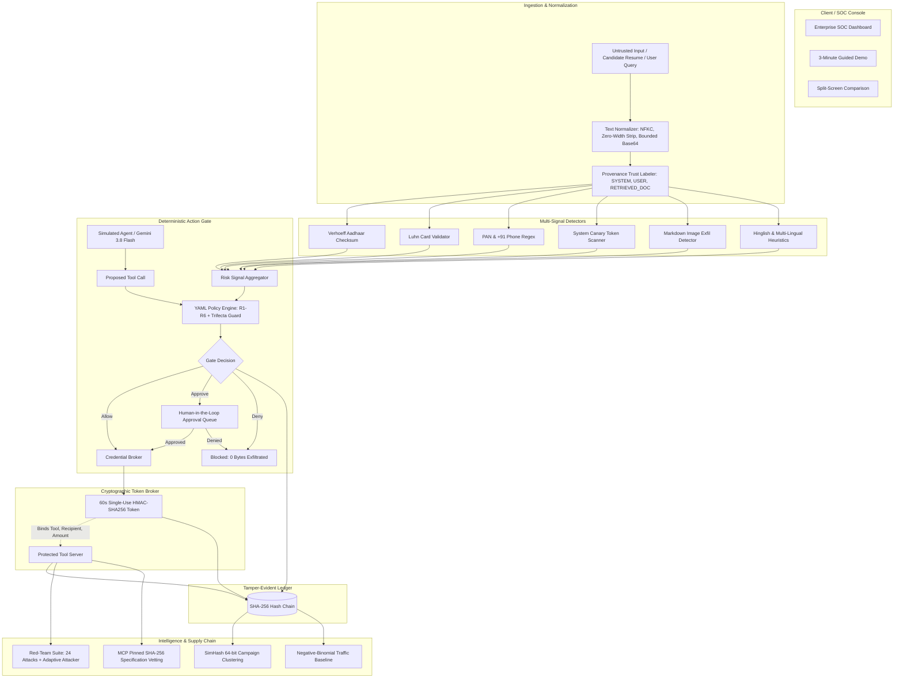

# LLM Firewall — AI Agent Security Gateway & Action Gate

> **Thesis**: *"Reading untrusted content should never authorize a sensitive action."*  
> Detectors produce probabilistic risk signals; the **Action Gate & Credential Broker** establish the **deterministic boundary for tool calls routed through the gate and verified by the tool server**. Never claims 100% protection or attacker identification.

---

## 1. System Architecture Diagram



---

## 2. What is Real vs. Simulated

| System Component | Status Chip | What is Real (Code / Math) | What is Simulated / Seeded | Architecture Rationale |
| :--- | :--- | :--- | :--- | :--- |
| **Action Gate & Policy Engine** | `[BUILT]` | Real YAML parsing (`js-yaml`), deterministic rule evaluation (R1–R6), and Trifecta Guard logic. | Evaluates live in-memory request graph. | The security boundary is deterministic, not probabilistic. |
| **Credential Broker & Tokens** | `[BUILT]` | Real HMAC-SHA256 signature generation, timing-safe verification (`crypto.timingSafeEqual`), 60s expiration enforcement, argument binding, and single-use JTI replay protection. | Token audience targets simulated internal tool server. | Standing master keys are prohibited when firewall is active. |
| **Cryptographic Audit Log** | `[BUILT]` | Real SHA-256 append-only hash chain (`Hash_n = SHA-256(Hash_{n-1} + canonical_JSON)`). Cryptographic tamper detection and chain walking. PII values masked via server-side HMAC-SHA256. | Tail truncation is not detectable without an external witness anchor (`[ROADMAP]`). | Mathematical tamper detection without trusting local storage. |
| **Verhoeff & Luhn Checksums** | `[BUILT]` | Exact Dihedral $D_5$ group multiplication and permutation matrices for 12-digit Indian Aadhaar validation, plus standard Luhn card validation. | Aadhaar and card numbers are purely synthetic fake test fixtures. | Eliminates false-positive redaction on random 12-digit numbers. |
| **Heuristics & Hinglish Detectors** | `[BUILT]` | Safe ReDoS-resistant regex patterns, NFKC normalization, zero-width character stripping, bounded base64 decoding, offset preservation, and Hinglish seed set. | Seed dictionary is intentionally a compact representative seed set. | Demonstrates multi-lingual signal capture without heavy LLM latency. |
| **Simulated Fooled Agent** | `[BUILT]` | Deterministic vulnerable agent simulating a hijacked model that obediently follows prompt injections, reliably proving Action Gate enforcement. | Simulates an obedient LLM without external API latency or variance. | Guarantees reproducible, reliable demo execution. |
| **Gemini Server-Side Agent** | `[PROTOTYPE]` | Server-side Gemini API integration via `@google/genai` TypeScript SDK (`gemini-3.8-flash`) with automatic graceful fallback to mock mode. | Real LLM adherence to prompt injection varies probabilistically. | Real AI engine option with zero-dependency fallback. |
| **SimHash Campaign Clustering** | `[BUILT]` | 64-bit locality-sensitive SimHash with Hamming distance matching <= 3 bits across attack payloads. | Payloads sourced from seeded synthetic attack library. | Clusters attacks across multiple independent agent apps. |
| **Traffic Baseline Anomaly Engine**| `[PRECOMPUTED]` | Offline precomputed coefficients in JSON (negative-binomial regression with log(requests) offset, hour/weekday, and app/user random effects). Calculates expected count and 95% band. | 14 days of hourly traffic data (336 hours) pre-generated with injected anomalies. | Empirical-Bayes shrinkage ranks accounts without 1-request false spikes. |
| **MCP Tool Specification Vetting**| `[BUILT]` | Computes SHA-256 hash of tool specifications. Detects prompt injection in tool docstrings and immediately triggers QUARANTINED state upon rug-pull simulation. | Simulated Model Context Protocol (MCP) server registry. | Demonstrates defense against tool supply-chain poisoning. |
| **Incident Response & Legal Drafts**| `[PROTOTYPE]` | Interactive SVG blast-radius graph layout. Agent emergency kill-switch key revocation. Regulatory draft templates for CERT-In 70B and DPDP 2023 with mandatory legal disclaimers. | Prototype drafts for evaluation; not submitted to actual government portals. | "Draft for legal and security review. Not legal advice." |
| **External Witness Anchor** | `[ROADMAP]` | Planned public transparency log or RFC 3161 timestamping service to detect tail truncation. | Currently uses in-memory hash chain. | Required to mathematically detect dropping of trailing blocks. |
| **Shared Threat Intelligence Feed**| `[ROADMAP]` | STIX 2.1 JSON export capability is built and functional. | Multi-tenant peer-to-peer threat sharing requires production customer tenants. | Card shown as disabled roadmap item in UI. |

---

## 3. Standing Master Key vs. Scoped Broker Token

- **Firewall OFF (Legacy Vulnerable Pattern)**:
  The agent holds a standing master key (`MASTER_KEY_SECRET`). It has no argument restrictions, infinite lifetime, no nonce validation, and can be replayed endlessly by any prompt injection that compromises the model.
- **Firewall ON (LLM Firewall Pattern)**:
  The agent holds **zero standing tool credentials**. Tool calls pass through the Action Gate. If approved, the Credential Broker issues a single-use, 60-second HMAC-SHA256 micro-token cryptographically binding only security-relevant constraints (`tool`, `recipient`, `amount`, `upiId`). The tool server verifies the token using `crypto.timingSafeEqual` and strictly rejects replays or argument tampering.

---

## 4. Quickstart & Running the Application

### Local Development
```bash
# Install dependencies
npm install

# Start full-stack development server (Express backend + Vite frontend on port 3000)
npm run dev
```

Visit `http://localhost:3000` to interact with:
1. **Start 3-Minute Demo**: Guided 6-step walkthrough demonstrating attack exfiltration, gate enforcement, audit walk, adaptive attacker bypass, and agent quarantine.
2. **Split-Screen View**: Side-by-side comparison of "Without Firewall | With Firewall" for identical attack vectors.
3. **Red-Team Suite**: 24 synthetic attack test cases + Adaptive Mutation Engine demonstrating that heuristic detectors can be bypassed while the Action Gate holds.
4. **Self-Test Suite (`/selftest`)**: 29 automated test vectors verifying Verhoeff checksums, Luhn, Token replay rejection, 10 policy vectors, canary tokens, and MCP tool vetting.
5. **Pitch & Architecture**: Overview of the 5-step pipeline with printable/scannable QR codes.

### Production Build & Test
```bash
# Build Vite client SPA
npm run build

# Run TypeScript linter
npm run lint

# Start production server
npm start
```

---

## 5. Deployment to Google Cloud Run

The application is container-ready and runs on any standard Node.js 22 runtime:

```bash
# 1. Build and deploy directly to Cloud Run
gcloud run deploy llm-firewall \
  --source . \
  --platform managed \
  --region asia-east1 \
  --allow-unauthenticated \
  --port 3000 \
  --set-env-vars "NODE_ENV=production,GEMINI_MODEL=gemini-3.8-flash"
```

---

## 6. Environment Variables

| Variable | Default Value | Description |
| :--- | :--- | :--- |
| `PORT` | `3000` | Port for the Express server and Vite development middleware. |
| `GEMINI_API_KEY` | Injected by AI Studio | Server-side API key for Gemini model inference. |
| `GEMINI_MODEL` | `gemini-3.8-flash` | Gemini model alias used when LLM mode is set to Gemini. |
| `BROKER_HMAC_SECRET` | Auto-generated secure secret | Secret key used by the Credential Broker to sign single-use 60s tokens. |
| `MASTER_KEY_SECRET` | Auto-generated standing key | Standing master key used only when Firewall is toggled OFF (demonstration mode). |
| `AUDIT_SALT_SECRET` | Auto-generated audit salt | Server-side secret used to HMAC-hash PII before writing to audit entries. |

---

## 7. Known Limitations & Roadmap

1. **In-Memory Store**: This hackathon prototype stores incidents, outbox messages, and audit hash chains in memory. Production implementations would back these with PostgreSQL / Cloud SQL and cold object storage.
2. **Hash Chain Tail Truncation**: While inner block tampering is mathematically detected by the SHA-256 chain walk, deleting trailing blocks (tail truncation) requires an external witness anchor (e.g. RFC 3161 timestamping authority or public ledger), marked as `[ROADMAP]`.
3. **Probabilistic Nature of LLMs**: Heuristic prompt filters can never guarantee 100% detection against adaptive adversarial mutations; security guarantees are therefore established at the **Action Gate & Credential Broker** tool boundary.
