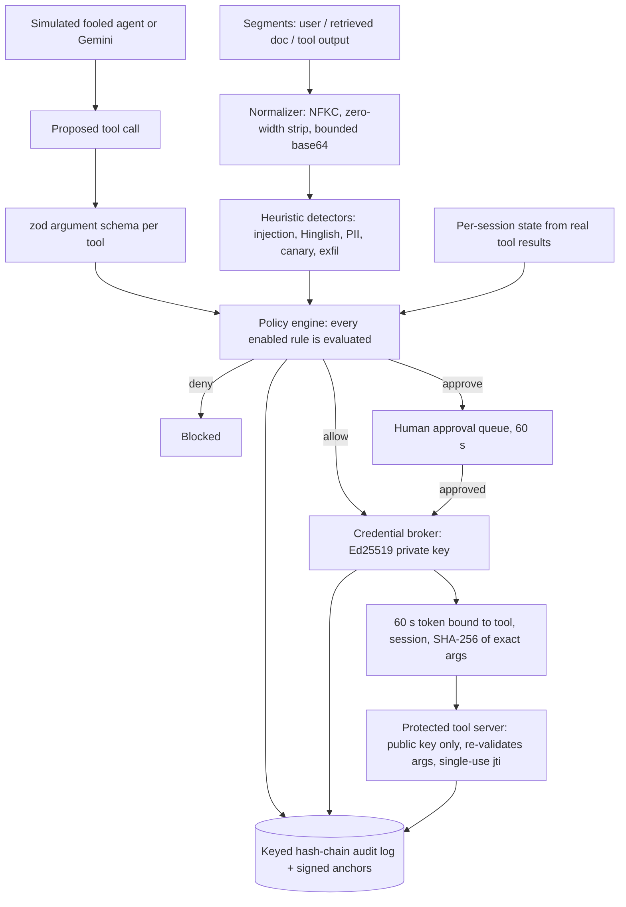

# Armora: Action gate and credential broker for LLM agents

> **Thesis**: *"Reading untrusted content should never authorize a sensitive action."*
> Detectors are heuristics that produce risk signals. The enforcement lives in the **action gate** (policy engine) and the **credential broker + tool server**: a tool call only runs if the gate allows (or a human approves) *that exact call*, and the tool server verifies a signed token bound to it.
> This is a prototype. It does not claim to stop every attack, and nothing here is a proof.

---

## 1. Architecture



### Components

| Component | Status | What the code really does | What is simulated / limited |
| :--- | :--- | :--- | :--- |
| Policy engine (`server/policyEngine.ts`) | `[BUILT]` | Validates policy YAML with zod (unknown fields and rule ids rejected). Evaluates **every** enabled rule, returns all matches in `matchedRules[]`, and picks the most restrictive (deny > approve > allow). Fails closed (`POLICY_ERROR` deny) on any evaluation error. | Rules not listed in a policy are *not* enforced (the save response warns). |
| Session state (`server/sessionState.ts`) | `[BUILT]` | `{untrustedIngested, privateDataAccessed, toolCalls[], dataObjects[]}` is updated from the **actual results** of tools that read private data. The trifecta rule reads this state. | Scenarios run their legitimate read-only steps through the gate first (`preToolCalls`). |
| Email recipient check (`server/emailRecipients.ts`) | `[BUILT]` | `to`, `cc`, `bcc` are merged and parsed with the `email-addresses` package; domains are lowercased, converted to punycode and compared **exactly** to the allow-list; every address must pass. A raw-text scan rejects display-name tricks. | Parsing is only as good as the parser plus these checks; internationalised local parts are rejected. |
| Credential broker (`server/credentialBroker.ts`) | `[BUILT]` | Ed25519 signed tokens with `kid`, key rotation (previous key accepted for at most one TTL), claims `jti, sub, sessionId, tool, argsHash, approvalId, iat, nbf, exp<=60s, aud`. The tool server verifies with the public key only and rejects bad signature, expiry, audience, tool, session, argument-hash mismatch, replay and revoked tokens. The kill switch revokes all outstanding tokens of the agent. | The jti replay store is in memory and local to one tool-server process. |
| Tool argument schemas (`server/toolSchemas.ts`) | `[BUILT]` | One strict zod schema per tool; unknown/extra arguments rejected before the gate and again at the tool server. | Only the five demo tools exist. |
| Legacy standing key (`server/legacyStandingKeyDemo.ts`) | `[SIMULATED]` | Labelled **"Simulation of the legacy pattern"**. A random-per-boot key used only by the firewall = OFF scenario. The real `executeTool` has no master-key path and no "firewall off" flag. | It exists to show the old pattern, not as a real credential path. |
| Audit log (`server/auditLog.ts`) | `[BUILT]` | `hash = HMAC-SHA256(auditKey, prevHash + canonical entry)`, persisted to append-only JSONL (`AUDIT_DIR`), reloaded and verified on boot. Signed anchors every 10 entries or on demand in a separate file (`GET /api/audit/anchors`); `verifyChain` compares against the latest anchor to detect tail truncation. | Hash-chained and keyed; detects edits, deletions and reordering; an attacker with both the key and the files can still forge; external anchoring is the production fix. The anchors are a **local witness simulation; production would use an external transparency log or RFC 3161 timestamping.** |
| Detectors | `[BUILT]` | Verhoeff, Luhn, PAN/phone regex, canary token, markdown-image exfil, English + Hinglish injection heuristics. | Heuristics; they have false negatives and false positives (shown in the red-team report). |
| Red-team runner (`server/redteam.ts`) | `[BUILT]` | Runs a hand-written seed set against an **isolated** broker and tool server and counts harm only if the action really executed. The conclusion text is computed from the metrics. | Small seed set written by the same team as the detectors and policy. |
| Gemini agent (`server/gemini.ts`) | `[PROTOTYPE]` | `GEMINI_MODEL` is configurable and probed with a tiny call at boot. If unavailable, a banner is shown and runs fall back to the simulated agent **and are labelled as simulated**. | Tool calls are parsed with regexes from free text. Real models may not follow injections. |
| Traffic baseline, SimHash clustering, MCP vetting, incident drafts | `[PRECOMPUTED]` / `[PROTOTYPE]` | As before: precomputed coefficients, SimHash, pinned tool-spec hashes, CERT-In/DPDP draft templates. | Seeded data. Drafts are not legal advice and are not submitted anywhere. |

---

## 2. Threat model

**Assets**: private records behind tools (candidate files, orders), money movement (refunds), outbound email, the signing key, the audit log.

**Attacker**: someone who can place text in anything the agent reads (resume, ticket, tool output, web page) and therefore can steer the model; or who can steal and replay a token; or who can call the HTTP API.

**Assumptions**: the Armora server, the broker private key and the tool server run in a trusted environment; the operator keeps `ADMIN_TOKEN`, `BROKER_ED25519_SEED` and `AUDIT_HMAC_KEY` secret; humans in the approval queue read what they approve.

| Threat | Mitigation in this repo | Residual risk |
| :--- | :--- | :--- |
| Injected text makes the model request a harmful tool call | Policy engine on the *call* (untrusted context + external tool, private data read, risk score, recipients, UPI handles, amount), independent of detectors | Calls that look legitimate to the policy (e.g. email to an allow-listed domain from a trusted session) are allowed. |
| Recipient tricks (lists, cc/bcc, display names, lookalike or IDN domains) | Real address parser, all recipients checked, exact punycode domain match | Parser edge cases; allow-listed domains are fully trusted. |
| Argument swap / token reuse | Token bound to tool, session and SHA-256 of the exact validated args; single use; 60 s; revocation | Replay store is per process. |
| Tool server minting its own tokens | It only holds the public key | Compromise of the broker process compromises everything. |
| Log tampering | Keyed hash chain, JSONL on disk, verification at boot, signed anchors | Attacker with key + files can forge; deleting the anchors file defeats local truncation detection. |
| Unauthorised API use | `ADMIN_TOKEN` required for mutating routes in production, zod validation of bodies, allow-listed PATCH fields, CORS limited to `APP_URL`, CSP in the production build, rate limits, safe error handler | Single shared admin token; no per-user auth or RBAC. |
| Secret leakage via source | No hard-coded secrets; random per boot unless provided by env | Random keys mean tokens do not survive restart. |

**Out of scope**: model jailbreaks in general, malicious insiders with shell access, denial of service, multi-tenant isolation, real PII handling (all data is synthetic).

---

## 3. Limitations (read this before relying on anything)

1. **Prototype, in-memory state.** Incidents, approvals, the outbox and the jti store are in memory. Only the audit log is persisted.
2. **Local audit key.** If `AUDIT_HMAC_KEY` is not set, the key is stored next to the logs in `AUDIT_DIR`, so a disk-level attacker can forge. Local anchors do not fix that; external anchoring (transparency log, RFC 3161) would.
3. **Detectors are heuristics** and are bypassable (the adaptive-attacker panel demonstrates it with a few mutations). Guarantees come from the gate and token layers, only for calls routed through them.
4. **Seed-set metrics.** Red-team numbers are measured on a small hand-written set ("on our seed set, n=..."). Some seed attacks to allow-listed domains from trusted sessions can execute by policy design; the report shows them instead of hiding them. Attacks held for approval are reported separately and are never counted as blocked.
5. **Simulated agent.** The default agent deterministically follows the injection. It demonstrates the gate; it says nothing about how any real model behaves.
6. **Gemini.** Availability is probed once at boot. Output from the simulated fallback is always labelled as simulated.
7. **Single admin token**, no user accounts, no RBAC. The settings page tenants/roles are illustrative.
8. **Replay store** is per tool-server process; a horizontally scaled tool server needs a shared store.
9. **Offline caveat for this change set**: dependencies could not be installed in the authoring sandbox, so `package-lock.json` has to be generated with `npm install` and committed (see below).

---

## 4. Quickstart

```bash
npm ci            # needs a committed package-lock.json
npm run lint      # tsc --noEmit
npm test          # vitest --run
npm run dev       # Express + Vite on http://localhost:3000
```

Node >= 22 is required. The same regression cases run in `npm test` and in the app at `GET /api/selftest` (the Self-Test page); cases that touch live singletons run only under vitest, and the report says how many.

Production:

```bash
npm run build
NODE_ENV=production ADMIN_TOKEN=... BROKER_ED25519_SEED=... AUDIT_HMAC_KEY=... APP_URL=https://your.host npm start
```

In production, mutating routes (approvals, policy, reset, app settings, kill switch, blocklist, MCP, traffic false-positive marking, anchor creation) need the `x-admin-token` header (or `Authorization: Bearer`). The UI has a field for it in the status banner. With no `ADMIN_TOKEN` configured those routes answer 503.

CI (`.github/workflows/ci.yml`) runs `npm ci`, `tsc --noEmit` and `vitest --run`.

---

## 5. Environment variables

| Variable | Default | Description |
| :--- | :--- | :--- |
| `PORT` | `3000` | HTTP port. |
| `NODE_ENV` | unset | `production` enables the admin-token requirement, CSP and static serving. |
| `DEMO_MODE` | `true` locally, `false` in production | Enables `/api/audit/tamper` and the `overrideToolCall` parameter. |
| `ADMIN_TOKEN` | unset | Required header value for mutating routes in production. |
| `APP_URL` | unset | The only origin allowed by CORS. Unset means same-origin only. |
| `GEMINI_API_KEY` | unset | Server-side Gemini key. |
| `GEMINI_MODEL` | `gemini-2.5-flash` | Model name; probed at boot, never assumed to exist. |
| `BROKER_ED25519_SEED` | random per boot (warning) | Base64 of 32 bytes; signing key seed for the credential broker. |
| `AUDIT_HMAC_KEY` | key file in `AUDIT_DIR` (warning) | Hex or string (>= 16 chars) used for the audit HMAC. |
| `AUDIT_DIR` | `./.audit` | Directory for `entries.jsonl`, `anchors.jsonl` and, if needed, `audit.key`. |
| `AUDIT_SALT_SECRET` | random per boot (warning) | Salt for HMAC-hashing PII evidence in findings. |

---

## 6. Honesty labels used in the UI

- **Simulation of the legacy pattern**: the firewall = OFF path (standing key). Never a real credential path.
- **Simulated fooled agent**: the default "mock" agent; not a model.
- **Local witness simulation**: the audit anchors.
- `[BUILT]`, `[PROTOTYPE]`, `[SEEDED]`, `[PRECOMPUTED]`, `[ROADMAP]` chips as shown in the Real vs Simulated page.
